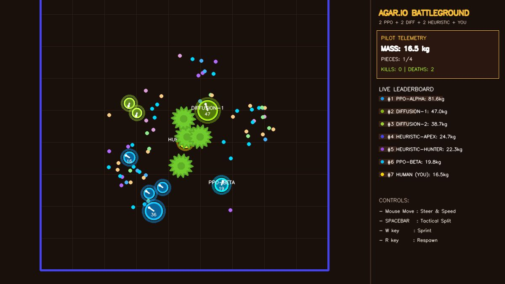

<!-- Preserved from the repository front page before the project showcase rewrite. -->

# Checkpoint history and navigation reproduction

A playable multi-agent continuous-control testbed comparing a hybrid PPO policy with an action-diffusion policy. The implementation uses a shared 30 Hz environment, visible piece-level motion, strict checkpoint loading, and reproducible comparisons against frozen previous agents.

This is a simulated arena. The retained robot-navigation prototype has **not** demonstrated transfer to a physical robot.

## Play

```bash
pip install -r requirements.txt
python scripts/play_agar_web.py --host 127.0.0.1 --port 8080
```

Open **http://localhost:8080/**. Move the mouse to steer, hold **W** to sprint, press **Space** to split, and press **R** to reset the match. The server loads the accepted checkpoints through `outputs/split_combat_v3/deployment.json` and rejects missing, incompatible, or checksum-mismatched models. `/status` reports the loaded model hashes and control timestep. Importing the web module does not start a game thread. Use `--policy-dir outputs/arena_v2` to play the previous checkpoint.



## Current checkpoint: learned split attacks — October 27, 2026

The previous training replay had just **9 positive split labels in 79,800 observations**. Both agents now use a dedicated binary split head trained on paired simulator trials: an attack is positive only if its launched piece captures the target earlier than holding, without immediate attacker damage. Continuous navigation weights, the return critic, the `0.65` request threshold, and the safety rules are unchanged. Diffusion uses a separate discrete head; its denoiser still controls movement.

| Fresh physical test | PPO | Diffusion |
| --- | ---: | ---: |
| Beneficial opportunities captured by projectile | **120/125 (96%)** | **119/126 (94.4%)** |
| Total projectile captures / encounters with attacks | **184/186** | **172/175** |
| Executed splits violating safety checks | **0** | **0** |
| Previous-v2 projectile captures on the same encounters | 0 | 0 |

This test contains 996 valid randomized encounters per algorithm; four initial allocations exceeded the curriculum mass cap and were excluded. In twelve full matches per algorithm against previous-v2 agents, the new PPO made **2 splits / 2 projectile captures** and diffusion made **1 split / 2 captures**, versus zero splits for the previous policies. Attacks remain rare in ordinary play. Both pass the predeclared navigation-retention tolerance; diffusion had **4 deaths versus 2** for its previous baseline, so this is not a survival-improvement claim.

See [the complete split results, limitations, and reproduction commands](split_combat_results_2026-10-27.md). The agents remain beatable, and aggressive pursuit and trap escapes still need work.

## Previous checkpoint: growth and survival — October 27, 2026

Each algorithm was tested in 12 independent 60-second matches. Each match contained two new agents, two original agents of the same algorithm, and three heuristic opponents. Seats were shuffled. The primary comparison is the difference in pair-average mass gained, not the number of outright individual game wins.

| Metric | Original PPO | New PPO | Original diffusion | New diffusion |
| --- | ---: | ---: | ---: | ---: |
| Mean final mass per agent | 28.04 | **71.01** | 24.58 | **68.42** |
| Full deaths across all matches, including respawns | 74 | **2** | 56 | **0** |
| Matches with greater pair-average mass gain | — | **10/12** | — | **12/12** |
| Mean inference time on this Mac | 0.19 ms | 0.22 ms | 0.44 ms | 0.49 ms |

The mean mass-gain advantage was **42.78** for PPO (match-bootstrap 95% interval **21.11–60.71**) and **43.65** for diffusion (**29.79–57.05**). These are held-out initial-state seeds in this arena, not evidence of human-level play or general sim-to-real transfer. Wall contacts remain an issue, especially for diffusion.

In separate close-range exploit tests, both new agents survived the four split-bait cases that killed the originals. Both still failed the head-on predator, flanking predator, and corner-trap cases. The agents remain beatable.

See the [full results, ablations and limitations](arena_v2_results_2026-10-27.md) and the [initial critical assessment](critical_assessment_2026-10-27.md).

## What changed

- PPO preserves the sampled continuous action for both old and new likelihoods. Only the environment command is clipped. Kill/death bonuses use event deltas; time-limit bootstrapping is separate from deaths and episode resets.
- Version 2 observations retain the legacy 38 fields and append visible opponent-piece motion/mass, own piece summaries, post-split danger, nearest food/virus vectors, and wall distances. Hidden opponents do not contribute.
- A measured safety filter rejects unsafe splits and intervenes near observable hazards. Ordinary neural actions are retained. The previous reflex is frozen only as a benchmark fixture.
- PPO was trained with imitation initialization followed by 121,344 learner transitions against a mixed opponent league.
- Diffusion was retrained with symmetric action normalization, a cosine noise schedule, averaged model weights, and a critic supervised on **observed discounted environment rewards**. Its action horizon is 16 physical control steps, with 3-step receding execution and emergency replanning.
- Version-2 navigation training, full-match evaluation, and browser play share their physical configuration. The later split-head encounter curriculum varies density and uses a 400-unit mass cap; the live/full-match cap stays 550. The browser limits opponent positions to the human player's visibility radius.

## Reproduce the previous navigation checkpoint

Use the repository root as the working directory. Training creates new outputs; it does not overwrite the historical champions.

```bash
# Recreate the recorded data and PPO training. The frozen initial teacher is
# retained because deployment clearance was revised after this training run.
python -m src.train_arena_v2 --output outputs/reproduction \
  --workers 4 --episodes 24 --episode-steps 600 --steps 120000 \
  --seed 260271 --bc-epochs 15 --schedule linear --teacher-version initial_v2

# Train the accepted diffusion variant on those same episode-separated data.
python -m src.train_arena_v2 --output outputs/reproduction_cosine \
  --diffusion-only --reuse-data --data outputs/reproduction/demonstrations.npz \
  --schedule cosine --symmetric-actions --diffusion-epochs 80 --seed 260271

# Evaluate the shipped accepted policies against frozen originals.
python -m src.evaluate_arena_v2 --algorithm ppo \
  --checkpoint outputs/arena_v2/ppo.pt --workers 2 \
  --output outputs/recheck_ppo.json
python -m src.evaluate_arena_v2 --algorithm diffusion \
  --checkpoint outputs/arena_v2_cosine/diffusion.pt \
  --critic outputs/arena_v2_cosine/critic.pt --workers 2 \
  --output outputs/recheck_diffusion.json

# Historical reports intentionally cannot promote changed source. Use the
# freshly regenerated reports to validate the previous navigation models.
python scripts/promote_arena_v2.py --ppo-report outputs/recheck_ppo.json \
  --diffusion-report outputs/recheck_diffusion.json --output outputs/recheck_v2_deployment.json

# Includes regression, physics, and web integration tests.
python -m unittest discover -s tests -v
```

For the current split checkpoint, follow the [split training/evaluation recipe](split_combat_results_2026-10-27.md#reproduction), then run `python scripts/promote_split_combat.py` against fresh reports. For **new** training/evaluation work, choose fresh final test seeds; the shipped final seeds are already public. Exact training replay across other hardware/library versions is not guaranteed. The recorded dataset checksums, configurations, checkpoints, and match records are included; raw training buffers are regenerated rather than committed.

## Layout

- `envs/arena_config.py`: shared environment contract.
- `src/arena_tactics.py`: observable teacher and safety interventions.
- `src/train_arena_v2.py`: data collection, hybrid PPO, diffusion and return-critic training.
- `src/arena_policies.py`: strict versioned inference and frozen baseline adapters.
- `src/evaluate_arena_v2.py`: matched-seat acceptance tournaments.
- `src/evaluate_encounters_v2.py`: scripted exploit diagnostics.
- `src/train_split_combat.py`, `src/evaluate_split_combat.py`: paired physical attack curriculum and held-out tests.
- `outputs/split_combat_v3/`: current split models, accepted manifest, audits and evidence.
- `outputs/arena_v2/`, `outputs/arena_v2_cosine/`: immutable previous models and evidence.
- `benchmarks/`: frozen historical reflex and recorded training teacher.

Older scripts, videos and experiments are retained as historical material. Their architecture, timings and headline statistics should not be substituted for the current acceptance reports. The [historical README](historical_arena_readme_2026-09.md) is preserved for provenance.
