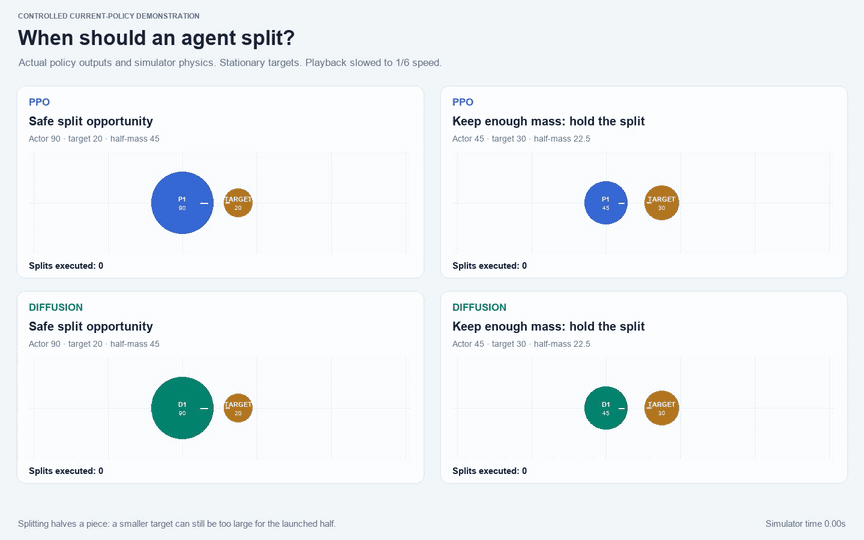

# Demo gallery

These are recordings and screenshots of the **current accepted policies and actual simulator state**. The light presentation is an offline spectator renderer; the interactive browser game's styling is separate. There are no fabricated gameplay frames or scripted split commands.

## Gameplay

[](media/showcase/gameplay.mp4)

**[Full gameplay video — MP4, 60 seconds, 1440 × 900](media/showcase/gameplay.mp4)**

Two PPO agents, two diffusion agents and three heuristic opponents compete individually. The movie shows the full first benchmark match, seed `4100001`, selected before looking at outcomes. It runs at **1× real time** with no cuts. The animation above shows seconds 5–15. Physics and decisions run at 30 Hz; video records every second state at 15 fps. All intermediate observations were processed.

The dashed circle on the spectator map follows PPO-1's sensing radius. The inset displays its local visibility footprint; policies receive a numeric observation, not rendered images. Colors: blue PPO, green diffusion, amber heuristics, pink viruses, small pale dots food. Short labels P1/P2 and D1/D2 identify learned agents; HA/HH/HS identify apex/hunter/survivor heuristic profiles. The leaderboard reports actual mass, opponent-piece captures, full deaths and executed splits.

Virus contact can fragment a large player without a split command. Multiple visible pieces therefore do not always imply a nonzero executed-split count.

## Screenshots

**[Arena overview at 15 seconds — full-resolution PNG](media/showcase/overview.png)**


**[Local sensing and agent state at 45 seconds — full-resolution PNG](media/showcase/local_sensing.png)**


## Split decisions

[](media/showcase/split_decisions.mp4)

**[Split-decision video — MP4, 9.2 seconds, 1440 × 900](media/showcase/split_decisions.mp4)** · [Still image](media/showcase/split_decisions.png)

Four controlled cases show the current PPO and diffusion policies against stationary targets. The left column starts at actor mass 90 / target 20; splitting leaves a 45-unit launched half, and both policies capture the target. The right column starts at 45 / 30; a 22.5-unit half cannot eat the target, so both keep their split. The target can still be captured later by ordinary body contact; holding a split does not require stopping movement.

The video shows **1.2 simulator seconds at 1/6 speed**, plus one-second opening and closing holds. The actual simulator clock is printed. These are explicitly illustrative cases, not a random combat sample or part of the final benchmark. Every action comes through the deployed policy and safety layer; the renderer does not force a split. [Recorded scene outcomes](../outputs/showcase_v1/illustrative_decisions.json) include the capture step and executed split count.

## Benchmark graphic


**[Download full-resolution chart](media/showcase/benchmarks.png)** · [Metric definitions and protocol](benchmarks.md) · [Raw match data](../outputs/showcase_v1/benchmark.json)

The chart shows growth, death-free agent runs, captures per agent-minute, and a separately labeled split-opportunity test. It does not use historical policies as the main comparison.

## Rebuild the showcase

Install the usual project requirements, the optional `requirements-media.txt`, and the `ffmpeg` executable (including `ffprobe`). Run from the repository root:

```bash
python -m pip install -r requirements-media.txt

# Optional: generate a new benchmark and its first-seed trace. This overwrites
# the showcase outputs, so preserve shipped artifacts if comparing runs.
PYTHONDONTWRITEBYTECODE=1 python -m src.benchmark_showcase

# Or render directly from the shipped trace and benchmark, without a rerun.
PYTHONDONTWRITEBYTECODE=1 python scripts/build_showcase.py
PYTHONDONTWRITEBYTECODE=1 python scripts/verify_showcase.py
```

The renderer reads `outputs/showcase_v1/demo_trace.json.gz`; rebuilding ordinary gameplay does not run policy inference. The split illustration does run the accepted policies. Font selection prefers Arial on macOS, falling back to DejaVu Sans. Fonts, ffmpeg and library versions can change image/video bytes; the trace and policy outcomes are the underlying evidence.

The [media manifest](../outputs/showcase_v1/media_manifest.json) records asset checksums, source trace checksum, model checksums, seed and playback speeds. [Verification](../outputs/showcase_v1/verification.json) checks source/model/data hashes, benchmark arithmetic, trace timesteps, video codecs/dimensions/frame counts, image decoding and local documentation links. Legacy demo scripts target older experiments; use `scripts/build_showcase.py` for these accepted models.
