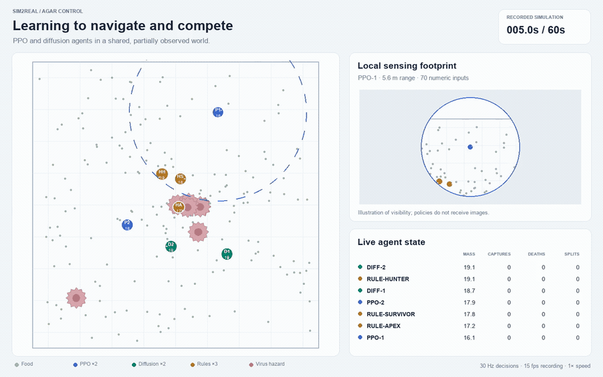
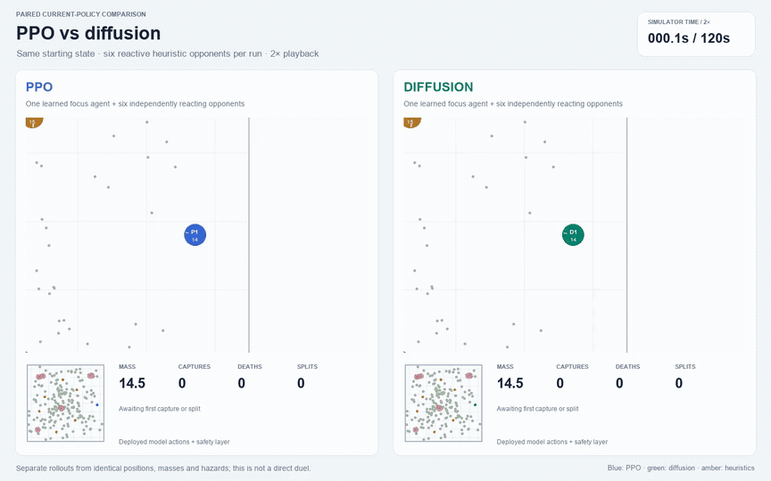
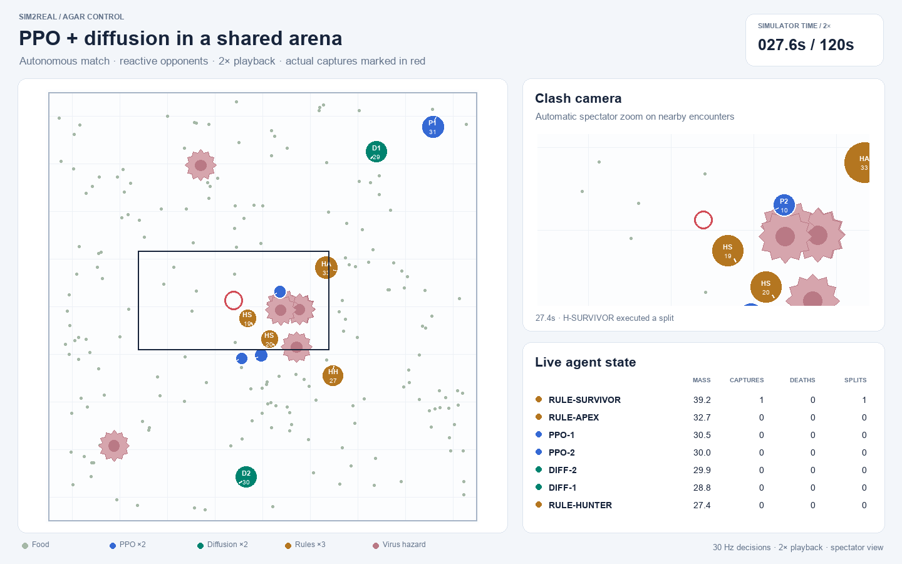
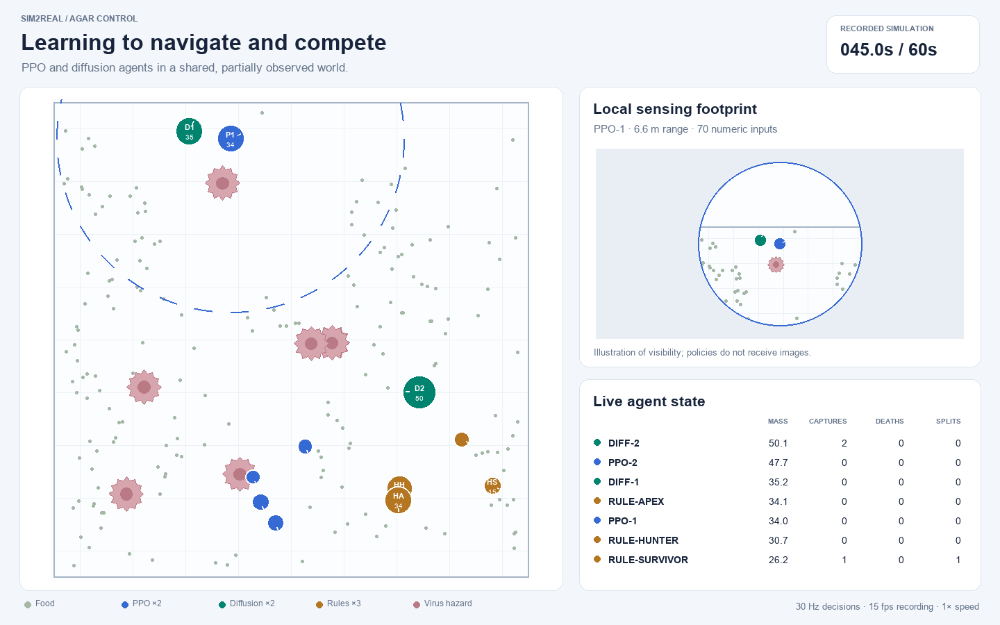
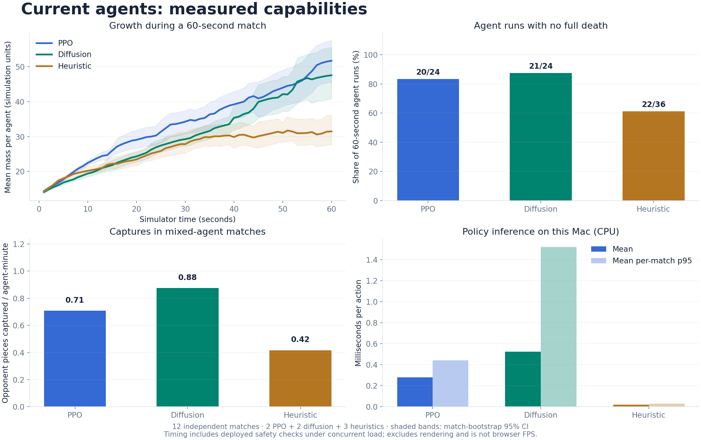

# Clashes and policy comparisons

Actual autonomous matches with the accepted policies. Both full videos run for **60 seconds at 2× speed**, showing **120 simulator seconds**. There are no stationary-target demonstrations or forced split commands. The light layout is an offline spectator presentation; the browser game's styling is separate.

## Shared match: PPO, diffusion and reactive opponents

[](media/showcase/gameplay.mp4)

**[Full gameplay — MP4, 60 seconds, 2× speed, 1440 × 900](media/showcase/gameplay.mp4)**

Two PPO agents, two diffusion agents and three heuristic opponents compete individually. Seed `4100001`, extended to 120 simulator seconds. The full recording contains **10 piece captures and 4 full deaths**. A spectator camera follows encounters; red rings and event labels mark actual consumption events. The map rectangle shows the zoomed area. The full video is uncut; the animation shows its first 30 playback seconds.

Blue: PPO; green: diffusion; amber: heuristic opponents; pink: virus hazards; pale dots: food. The leaderboard records actual mass, piece captures, full deaths and split executions. Virus contact can fragment a player without a split command, so multiple pieces do not necessarily imply an executed split.

## PPO vs diffusion: identical starts, active opponents

[](media/showcase/policy_comparison.mp4)

**[Full comparison — MP4, 60 seconds, 2× speed, 1440 × 900](media/showcase/policy_comparison.mp4)** · [Comparison screenshot](media/showcase/policy_comparison.png)

Each side begins with the same ordinary arena reset, seed `4200001`: identical positions, masses, food and hazards. One learned focus agent faces six heuristic opponents, with two each of the apex, hunter and survivor profiles. Opponents act throughout and react independently as each rollout evolves. This is **not a direct duel**: the two policies run in separate copies of the starting arena.

| Outcome in this single paired demonstration | PPO focus agent | Diffusion focus agent |
| --- | ---: | ---: |
| Opponent pieces captured | 4 | 3 |
| Full deaths | 0 | 0 |
| Executed splits | 2 | 0 |
| Final mass | 118.0 | 113.8 |
| Whole-arena captures, including opponents | 14 | 17 |

Every split is a deployed-policy action. The comparison does not force matching split counts or manufacture a favorable result. It illustrates behavior in one starting state; use the [twelve-match benchmark](benchmarks.md) for aggregate measurements. These recordings use the accepted v3 models and their existing safety layer. The physical-only v8 candidate has now been evaluated separately and remains experimental after a PPO survival-gate failure. These videos continue to show accepted v3; see [v8 results and its optional local preview](learned_split_risk.md#fresh-v8-results-and-playable-candidate).

## Screenshots of real clashes



[Download full-resolution overview](media/showcase/overview.png). The poster shows an actual capture near simulator time 27.6 seconds, rather than an empty opening frame.



[Download the later clash screenshot](media/showcase/local_sensing.png). This frame is near simulator time 110.9 seconds. Spectator views may show the full state; policies receive 70 local numeric features and never these images.

## Measured comparisons



[Full-resolution chart](media/showcase/benchmarks.png) · [Metric definitions and protocol](benchmarks.md) · [Raw benchmark data](../outputs/showcase_v1/benchmark.json)

The chart compares current PPO, diffusion and heuristic behavior across twelve independent standard matches. The demonstration videos are longer, separate recordings and do not replace or inflate those benchmark results.

## Rebuild

Install the project requirements, optional `requirements-media.txt`, and the `ffmpeg` executable (including `ffprobe`). From the repository root:

```bash
python -m pip install -r requirements-media.txt

# Re-record all three active rollouts, with every policy acting at 30 Hz.
PYTHONDONTWRITEBYTECODE=1 python -m src.record_clashes

# Or render from the shipped traces without re-running inference.
PYTHONDONTWRITEBYTECODE=1 python scripts/build_showcase.py
PYTHONDONTWRITEBYTECODE=1 python scripts/verify_showcase.py
```

Recording retains every second state (15 Hz) and all capture/split/death events. Rendering at 30 fps produces exactly 2× speed without skipping control observations. Each full video has 1,800 frames / 60 seconds. The animated previews are 30 playback seconds. Camera selection uses actual encounter geometry and nearby recorded capture events; it has no influence on policy actions or physics. Posters intentionally feature clashes.

Provenance: [recordings and model/source hashes](../outputs/showcase_clashes/recordings.json), [media hashes and playback metadata](../outputs/showcase_v1/media_manifest.json), [verification](../outputs/showcase_v1/verification.json). Font and encoder versions can change media bytes when rebuilding; trace states and actual policy outcomes are the underlying evidence. Historical stationary-target illustrations are not used in this gallery.
