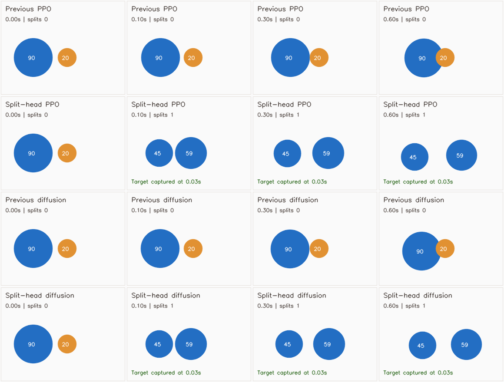

# Learning to use split attacks

The `9189015` agents improved survival and mass growth, but did not learn a usable split policy. Their 79,800-state training replay contained only **9 positive split labels (0.0113%)**. In a safe, aligned 90-versus-20 scene, PPO's split probability was **0.001806**; diffusion's split output was below **0.025**. The existing safety check allowed that attack. Lowering a threshold slightly would not solve this training imbalance.

## What changed

Both deployed policies now have a normalized 70 → 128 → 64 → 1 binary event head. PPO replaces its old linear split head. Diffusion uses a separate Bernoulli-style head evaluated on the **current observation every frame**, including frames that execute a buffered continuous action. This is a hybrid diffusion-navigation/discrete-combat policy; it is not a claim that the diffusion denoiser learned splitting.

Only the split heads were trained. PPO's movement/value weights, diffusion's denoiser, and the return critic remain bit-identical to the previous accepted models. The `0.65` request threshold and all existing split safety thresholds remain unchanged. No split/hold outcome oracle is available at inference.

The simulator now records the age of the particular launched piece that consumed another piece. Evaluation counts a projectile capture only within 18 simulator steps of launch. Ordinary body-contact kills do not count as split successes. This adds event instrumentation without changing collision physics, rewards, or movement.

## Training and selection

The curriculum randomizes actor/target masses, target velocity, bearing, camera-free world position/rotation, food counts, cooldown, walls, viruses, and third-party threats. These are simulator encounters, not footage or real robot tests. Most states rejected by the safety contract are hard negatives; all initially safe candidates and a sample of rejected states receive actual paired rollouts.

For a positive label, the **split branch must actually consume the target with a launched piece, at least three frames before the hold branch, without actor damage or death during the 18-frame horizon**. Both branches use the previous policy's movement and the same random seed. Guard violations cannot become positive labels.

- Generation: seeds `2800001..2806000`, 6,000 initial cases, both algorithms.
- Ten randomized initial allocations exceeded the curriculum's 400-unit mass budget and were excluded before fitting. All 5,990 remaining cases obey that budget. `data_audit.json` records the excluded seeds and canonical filtered-data hash. The live arena retains its existing 550-unit cap.
- Training: first 4,790 valid cases, with **669 PPO / 673 diffusion** beneficial attacks, plus negative replay from 10,000 old natural-play observations. Old safe opportunities are excluded from negative replay.
- Development: last 1,200 cases, with **160 / 159** positive opportunities.
- Balanced positive/negative minibatches; 80 epochs; checkpoint selection by the lowest balanced development BCE among the recorded ten-epoch checks. No final-test tuning.
- Development recall: **94.4% PPO / 93.7% diffusion**; raw request precision is recorded in `*_validation.json`. Request precision is not capture accuracy; the guard may veto requests.

The first collector wrote the ten overbudget negative cases into the raw JSONL; the final fitting pass used `--reuse-data` and explicitly filtered them. Fresh collection with current code excludes them directly, so its raw-file hash will differ. The canonical valid-row hash in `data_audit.json` is the appropriate data-content comparison. Raw replay buffers are ignored by Git; final models, configurations, audits, and evaluation rows are committed.

## Evaluation protocol

`outputs/split_combat_v3/acceptance_protocol.json` was written before final evaluation. It separates **attack usefulness** from **navigation retention**.

1. Development smoke test: 240 fresh cases starting at `3000001`. PPO captured all **30/30** beneficial opportunities with a projectile; diffusion captured **29/30**. Old policies made zero split attacks. This small smoke test deliberately does not pass the final gate's minimum of 50 beneficial opportunities.
2. Final physical test: 1,000 fresh encounters starting at `3100001`, both algorithms. Gate per algorithm: at least 50 beneficial opportunities; fire in at least 85%; projectile capture in at least 80%; zero per-frame guard violations; at least 30 more projectile captures than the previous model. Invalid initial allocations are excluded explicitly. Cases may become safe later, so a later legal attack does not count as a violation merely because the initial frame was unsafe.
3. Retention: 12 fresh 1,800-step matches per algorithm, seeds `3310001 + 37*i`. Each arena contains two candidates, two previous-v2 policies, and three heuristic opponents, assigned shuffled seats. The comparison baseline is **9189015 v2**, not the much weaker original bots. Acceptance requires mean final mass ≥90% of v2 and no more than two additional **total** deaths across the twelve matches. This is an engineering tolerance, not a statistical noninferiority result. Shuffled seats within a match are not identical-state counterfactual runs.

The promotion script recomputes the gates from individual rows and checks source/checkpoint hashes. The historical v2 acceptance files are preserved and cannot promote changed source. Reports must be regenerated for future inference, environment, or evaluator changes; do not replace historical source hashes by hand.

## Final results

Both physical-combat gates and both full-match retention gates passed. There were **996 valid final encounters per algorithm**; four initial overbudget allocations were excluded by the same rule used during training.

| Held-out physical test | PPO | Diffusion |
| --- | ---: | ---: |
| Paired beneficial opportunities | 125 | 126 |
| Beneficial opportunities fired on and captured | **120 (96.0%)** | **119 (94.4%)** |
| Encounters with an executed attack | 186 | 175 |
| Encounters with a projectile target capture | 184 | 172 |
| Previous-v2 attacks / projectile captures | 0 / 0 | 0 / 0 |
| Initially unsafe encounters | 769 | 769 |
| Per-frame guard-violating executions | **0** | **0** |
| Attacker-damage encounters, new / previous | 0 / 0 | 0 / 0 |
| Raw initial request precision for the paired-benefit label | 80.4% | 79.7% |

Raw request precision is lower than capture rate: some initially requested attacks are vetoed, and some captures provide less than the required three-frame advantage over holding. The capture rates above use the explicitly stated denominators; they are not accuracy on every possible combat state.

| Full matches against previous-v2 policies | New PPO | Previous PPO | New diffusion | Previous diffusion |
| --- | ---: | ---: | ---: | ---: |
| Mean final mass per agent | 59.82 | 46.42 | 47.84 | 45.22 |
| Total full deaths across 12 matches | 2 | 4 | 4 | 2 |
| Total executed splits | 2 | 0 | 1 | 0 |
| Total recent-projectile piece captures | 2 | 0 | 2 | 0 |
| Mean wall-contact frames per two-agent group per match | 136.42 | 39.67 | 77.00 | 80.58 |
| Mean measured inference, CPU under parallel load | 0.86 ms | 0.60 ms | 1.73 ms | 1.58 ms |

All successful natural-play splits occurred in PPO seeds `3310001`, `3310075`, and diffusion seed `3310149`. Split count and piece-capture count differ when one launched piece consumes multiple pieces. Natural-play opportunities remain sparse. Diffusion's two extra deaths are exactly the allowed retention tolerance; do not call this a survival improvement. PPO wall contacts increased in this sample and remain unresolved. These shuffled-seat mass comparisons should not be interpreted as showing that the few split actions caused all of the mass difference. Diffusion's mass-gain difference interval includes zero.

The raw rows, model/source hashes, training-selection log, and accepted manifest are in `outputs/split_combat_v3/`. The promotion tool independently recomputed the gates from these rows. Tests cover actual projectile attribution, safe/unsafe learned decisions, frozen movement weights, diffusion event-head buffering, checkpoint/source tampering, duplicate evaluation cases, and failed retention/combat promotion.

All **67 tests passed**. The live server was restarted with the accepted manifest on `http://localhost:8080/`; its page returned HTTP 200, `/status` reported readiness with the exact accepted model hashes and no error, and the MJPEG stream decoded as a 1200 × 675 frame. `live_verification.json` records that check; its `processing_capacity_fps` field is processing capacity, not measured playback FPS.

## Controlled illustration



This **illustrative** scene is the safe 90-versus-20 case discussed above, with a stationary target 1.5 m ahead. Both new policies choose one split and capture in one simulator step (0.033 s); neither previous policy captures within 0.6 s. The scene is not part of the final acceptance set and should not be presented as an aggregate benchmark. Recreate it with `python scripts/render_split_comparison.py`.

## Reproduction

Use the project's shared Python environment, `PYTHONPATH=.`, CPU, and `PYTHONDONTWRITEBYTECODE=1`:

```bash
python -m src.train_split_combat --output outputs/reproduce_split --cases 6000 --workers 4
python -m src.evaluate_split_combat --directory outputs/reproduce_split \
  --cases 1000 --seed 3100001 --workers 4 --output outputs/reproduce_split/combat_acceptance.json
python -m src.evaluate_arena_v2 --algorithm ppo \
  --checkpoint outputs/reproduce_split/ppo.pt --baseline-version arena_v2 --workers 2 \
  --seeds 3310001 3310038 3310075 3310112 3310149 3310186 3310223 3310260 3310297 3310334 3310371 3310408 \
  --output outputs/reproduce_split/ppo_retention.json
python -m src.evaluate_arena_v2 --algorithm diffusion \
  --checkpoint outputs/reproduce_split/diffusion.pt --critic outputs/arena_v2_cosine/critic.pt \
  --baseline-version arena_v2 --workers 2 \
  --seeds 3310001 3310038 3310075 3310112 3310149 3310186 3310223 3310260 3310297 3310334 3310371 3310408 \
  --output outputs/reproduce_split/diffusion_retention.json
python scripts/promote_split_combat.py --directory outputs/reproduce_split
```

Training uses the previous `outputs/arena_v2/demonstrations.npz` for natural-play negatives. If absent, regenerate it using the recorded v2 data recipe in the README, then copy the regenerated `outputs/reproduction/demonstrations.npz` buffer to that expected path; do not overwrite previous model files or silently omit replay. Final seeds are public once committed: future model development needs a fresh final seed family. Exact numerical replay across different PyTorch/hardware versions is not guaranteed.

## Limits and next work

These changes teach the policies to use existing safe opportunities. They do not train more aggressive pursuit, opponent intent, multi-step combat plans, split escape, or virus attacks. The fixed safety filter remains conservative; post-split risk beyond 0.6 seconds is assessed only through full matches, not guaranteed by the training label. Natural-play split opportunities are much rarer than in the curriculum.

Close predator traps, corner escapes, wall contacts, and general sim-to-real transfer remain unresolved. Neither the previous growth benchmark nor this split benchmark proves that a skilled human cannot beat the agents. Avoid threshold-only fixes, rewarding the act of splitting without capture, counting body kills as projectile kills, changing movement weights without a fresh retention test, or tuning on public acceptance seeds and continuing to call them unseen.
